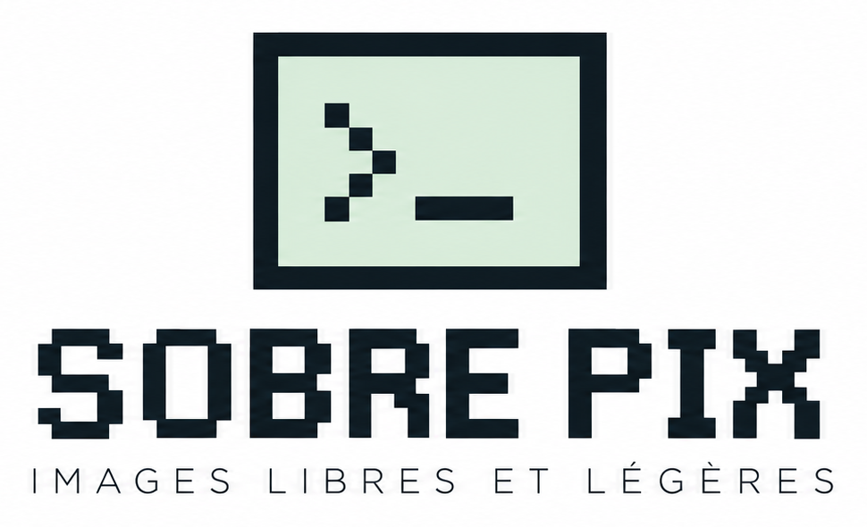

<p align="center">
  
</p>

# SobrePiX

**Une retouche photo frugale, pensée pour aller à l'essentiel.**

SobrePiX est le troisième logiciel de la gamme **SOBRE** (*logiciels libres et légers*), avec SobreTeX et SobrePdX. C'est une retouche photo très simple, au style Mac 1-bit des années 1980 (un clin d'œil assumé à MacPaint et au premier Photoshop). On ouvre une photo, on la recadre, on règle sa taille, sa lumière et ses couleurs, on y pose un texte ou un dessin, on peut la convertir en trame façon Mac 1984, puis on enregistre une copie.

> Version 0.1, premier jet destiné à tester et à amender l'ergonomie.
> © 2026 Auraponymous

---

## Pourquoi

Les logiciels de retouche courants font tout, et c'est bien le problème : pour recadrer une photo ou la réduire avant de l'envoyer, il faut traverser des dizaines de menus, de calques et de réglages qu'on ne comprend pas.

SobrePiX choisit l'inverse :

- **peu de fonctions**, celles dont on a besoin neuf fois sur dix : recadrer, redimensionner, éclaircir, corriger les couleurs, annoter ;
- **une interface lisible**, où chaque outil a sa palette, repliée tant qu'on ne s'en sert pas ;
- **l'original n'est jamais modifié** : on enregistre toujours une copie ;
- **un seul fichier léger**, qui s'ouvre sans installation, même sur un vieil ordinateur.

---

## Démarrer

SobrePiX tient dans **un seul fichier HTML** (environ 190 Ko), sans installation, sans serveur et sans connexion : la police et les icônes sont embarquées.

1. Ouvrez `index.html` d'un double-clic dans votre navigateur (Firefox, Chrome, Edge…).
2. La page d'accueil s'efface après 5 secondes, ou tout de suite au clic ou sur une touche.
3. Ouvrez une photo : bouton **Ouvrir une image…**, **Fichier › Ouvrir** (⌘O / Ctrl+O), glisser-déposer dans la fenêtre, ou collage (⌘V / Ctrl+V).
4. Retouchez avec les outils de gauche et les palettes de droite.
5. Enregistrez avec **Fichier › Enregistrer une copie…** (⌘S / Ctrl+S), en JPEG, PNG ou WebP.

Le fichier fonctionne aussi depuis une clé USB ou une fois hébergé sur GitHub Pages.

---

## L'interface

```
┌─ Barre de menus ── Fichier · Édition · Image · Affichage · Fenêtre · Aide ────────────────┐
├─ Outils ─┬─ Fenêtre de la photo ─────────────────────────────────────┬─ Palettes ────────┤
│ recadrer │ règles en pixels                                          │ ▭ Trame           │
│ texte    │                                                           │ ▭ Texte           │
│ crayon   │                 photo, retouches en direct                │ ▭ Taille          │
│ formes   │                                                           │ ▭ Réglages        │
│ …        │                                                           │ ▭ Dessin          │
│          │ barre d'état : taille en px et en cm · aide de l'outil    │ ▭ Recadrage       │
└──────────┴───────────────────────────────────────────────────────────┴───────────────────┘
```

- **Les palettes de droite** sont repliées au démarrage : seule leur barre de titre est visible, alignées les unes sous les autres. Un **double-clic sur la barre de titre** déplie ou replie une palette (façon « WindowShade » du Mac). Lancer un outil déplie aussi sa palette.
- Une palette dépliée **passe par-dessus les autres sans les décaler** : chacune garde sa place dans la colonne. Repliée, elle repasse dessous.
- Les palettes et la fenêtre de la photo se déplacent par leur barre de titre. **Fenêtre › Réinitialiser la disposition** remet tout en place, palettes repliées.
- Au survol, chaque outil affiche une **bulle** avec son nom et son raccourci.
- La **barre d'état** donne la taille de l'image (en pixels et en centimètres d'impression) ou, pendant un outil, ce qu'il faut faire.

### Palette Outils, de haut en bas

| Outils | Rôle |
|---|---|
| Recadrer · Texte | Tracer un cadre (C) · poser un texte (T) |
| Crayon · Formes | Dessiner à main levée (D) · ligne, rectangle, ellipse |
| Taille · Trame | Ouvrir la palette Taille · aperçu de la trame sur la photo |
| Pivoter à gauche · à droite | Rotation d'un quart de tour |
| Miroir horizontal · vertical | Retourner l'image |
| Annuler · Voir l'original | Annuler la dernière action · comparer avec la photo d'origine (maintenir le clic) |

---

## Les retouches

### Réglages

Cinq curseurs agissent en direct sur la photo, de −100 à +100 : **luminosité, contraste, saturation, température** (du froid au chaud) et **netteté**.

- Un **double-clic** sur un curseur le remet à 0 ; la **molette** l'ajuste finement.
- **Tout remettre à 0** efface tous les réglages d'un coup.
- Les réglages restent modifiables jusqu'à l'enregistrement. Ils ne sont intégrés à l'image qu'au moment de poser un texte, un dessin ou une trame.

### Recadrage

On trace le cadre directement sur la photo, on le déplace, on tire ses coins. Les proportions se choisissent dans la palette : **libre, 1:1, 4:3, 3:2, 16:9**, à l'horizontale ou à la verticale. Des repères aux tiers aident à composer. **Entrée** applique, **Échap** abandonne.

### Taille et résolution

La palette Taille montre la même image de deux façons, liées par la **résolution** :

| Bloc | Champs |
|---|---|
| **Écran (pixels)** | largeur et hauteur en px, échelle en %, boutons 25 / 50 / 75 % |
| **Impression** | largeur et hauteur en cm, résolution en ppp (points par pouce), boutons 72 / 96 / 150 / 300 |

La règle est simple : **cm = pixels ÷ ppp × 2,54**.

- Changer la **résolution** ne touche pas aux pixels : seule la taille d'impression change (une photo de 2400 px fait 84,7 cm à 72 ppp, 20,3 cm à 300 ppp).
- Taper une **taille en cm** recalcule les pixels à la résolution choisie : 15 cm à 300 ppp donnent 1772 px.
- La résolution est **lue à l'ouverture** (72 ppp si le fichier n'en indique pas) et **écrite à l'enregistrement** en JPEG et PNG.

### Texte

On tape le texte dans la palette, on clique sur la photo pour le placer, on le glisse, puis on le **pose** (⌘Entrée / Ctrl+Entrée). Réglages : quatre polices (Pixel, Sans, Serif, Mono), taille en pixels, huit couleurs, gras, contour (blanc ou noir selon la couleur, pour rester lisible sur toute photo).

### Dessin

Deux outils : le **crayon** à main levée et les **formes** (ligne, rectangle, ellipse). La palette Dessin règle :

- l'outil et le **remplissage** des rectangles et ellipses ;
- l'**épaisseur** du trait (aussi avec les touches `[` et `]`) ;
- l'**opacité** ;
- la **couleur**, parmi les huit couleurs de la gamme.

En maintenant **Maj**, la ligne se cale tous les 45°, le rectangle devient carré et l'ellipse un cercle. Chaque trait s'annule avec ⌘Z / Ctrl+Z ; **Échap** termine le dessin.

### Trame

La trame convertit une photo en image à deux couleurs, comme sur les écrans du Mac de 1984 ou dans la presse. L'**aperçu se fait directement sur la photo**, comme un filtre vivant qui se combine avec les réglages ; **Appliquer** l'intègre à l'image.

| Méthode | Rendu |
|---|---|
| Atkinson (par défaut) | Celle du Mac de 1984 : contrastes francs, grain fin |
| Floyd–Steinberg | Dégradés plus doux |
| Trame ordonnée | Motif régulier (matrice de Bayer 8×8) |
| Demi-teinte | Points ronds sur une grille à 45°, façon journal |
| Seuil net | Noir ou blanc, sans grain |

On règle le **grain** (réglé automatiquement pour rester visible à l'écran), le **contraste** et la **clarté**, et l'on choisit séparément l'**encre** et le **papier** parmi les huit couleurs de la gamme. Quand le grain est plus fin que les points de l'écran, la **loupe 100 %** (**Affichage › Loupe 100 %**) montre le grain réel sous la souris.

### Couleurs de la gamme

Les mêmes huit couleurs franches que Sobre TeX : noir `#000000`, blanc `#FFFFFF`, rouge `#D7141A`, bleu `#1F3FD1`, jaune `#FFE500`, vert `#128A2E`, orange `#B85400`, violet `#7A1FB8`.

---

## Enregistrement

| Mécanisme | Rôle |
|---|---|
| **Fichier › Enregistrer une copie…** (⌘S) | Produit une copie en JPEG, PNG ou WebP, nommée par défaut `nom_retouche`. L'original n'est jamais modifié. |
| Choix du dossier | Dans Chrome et Edge, on choisit le dossier. Dans Firefox, la copie va dans les Téléchargements. |
| Trame en aperçu | Si l'aperçu de la trame est actif, SobrePiX propose « Appliquer et enregistrer » ou « Enregistrer sans trame ». Après une trame, le PNG est proposé par défaut. |
| Taille d'impression | Le dialogue rappelle la taille d'impression (par exemple « 15 × 10 cm à 300 ppp »). |
| Alerte de fermeture | Si la photo modifiée n'est pas enregistrée, le navigateur demande confirmation avant de fermer l'onglet. |
| Fermer / Quitter | Dans le menu Fichier, avec la question « Ne pas enregistrer / Annuler / Enregistrer ». |

---

## Raccourcis clavier

SobrePiX affiche ⌘ sur Mac et Ctrl sur Linux et Windows.

| Action | Mac | Linux / Windows |
|---|---|---|
| Ouvrir | ⌘O | Ctrl+O |
| Enregistrer une copie | ⌘S | Ctrl+S |
| Coller une image | ⌘V | Ctrl+V |
| Annuler / Rétablir | ⌘Z / ⇧⌘Z | Ctrl+Z / Ctrl+Y |
| Recadrer | C | C |
| Texte | T | T |
| Crayon | D | D |
| Affiner / épaissir le trait | `[` / `]` | `[` / `]` |
| Appliquer le recadrage | Entrée | Entrée |
| Poser le texte | ⌘Entrée | Ctrl+Entrée |
| Annuler le recadrage ou le texte, finir le dessin | Échap | Échap |
| Remettre un réglage à 0 | double-clic sur le curseur | double-clic sur le curseur |

La liste est aussi dans **Aide › Raccourcis clavier…**.

---

## Choix techniques

- **Un seul fichier HTML autonome** : HTML, CSS et JavaScript sans bibliothèque ni étape de compilation, rien à télécharger au lancement.
- **Police embarquée** : Pixelify Sans (graisses 400 et 600), corrigée pour la gamme : Z redessiné (il ressemblait au 2), © à pleine taille, ligatures supprimées (« fi » s'affichait « Â »).
- **Icônes pixel** dessinées en tableaux de caractères et rendues sans lissage, pour rester nettes sur écran Retina.
- **Traitement d'image** sur `canvas` : l'aperçu est calculé à la résolution de l'écran pour rester fluide ; l'enregistrement recalcule tout en pleine définition. La réduction se fait par moitiés successives, pour une image nette.
- **Historique** : les réglages se rejouent sans copier l'image ; les actions qui modifient les pixels (recadrage, taille, texte, dessin, trame, rotation) gardent jusqu'à 8 états de l'image, pour ménager la mémoire.
- **Résolution** : lue dans les en-têtes JFIF et EXIF (JPEG) et dans le bloc `pHYs` (PNG), puis réécrite au même endroit à l'enregistrement.
- **Orientation** : les photos de téléphone s'ouvrent dans le bon sens (balise EXIF d'orientation respectée).
- **Stockage** : `localStorage` du navigateur, pour les préférences seulement (palettes masquées, réglages de texte, de dessin et de trame). Aucune image n'y est gardée.

---

## Limites connues (V0.1)

- **Formats lus** : ceux que le navigateur sait lire (JPEG, PNG, WebP, GIF, BMP, AVIF). Le TIFF et le HEIC des iPhone ne s'ouvrent pas.
- **Métadonnées** : la copie enregistrée ne garde pas les données EXIF (appareil, date, GPS…). C'est souvent souhaitable avant de partager une photo, mais à savoir.
- **WebP** : ce format ne retient pas la résolution d'impression.
- **Annulation** : environ 7 actions sur les pixels peuvent être annulées (chaque trait de dessin compte pour une).
- **Une seule photo à la fois**, sans calques : texte, dessin et trame sont définitifs une fois posés (sauf annulation).
- **Palettes dépliées** : elles masquent les barres de titre placées dessous ; il faut replier l'une pour atteindre l'autre (ou lancer directement l'outil).
- **Très grandes images** : au-delà de 250 millions de pixels, l'agrandissement est refusé.

---

## Feuille de route

- [ ] Ouverture possible d'une page blanche pour le dessin.
- [ ] Etoffer les outils dessin.
- [ ] Gomme et sélection rectangulaire (copier, coller, effacer).
- [ ] Recadrage aux dimensions d'impression (par exemple 10 × 15 cm à 300 ppp).
- [ ] Export PDF à la taille d'impression.
- [ ] Mettre à jour la version Linux native (Python/Tkinter), qui n'a pas encore le texte, le dessin, la trame ni la palette Taille.
- [ ] Version installable (PWA) : icône, fenêtre dédiée, hors ligne.
- [ ] **Application de bureau Tauri** (macOS, Windows, Linux) : vrais fichiers sur le disque, « Ouvrir avec SOBRE-PiX » depuis le gestionnaire de fichiers, raccourcis natifs.
- [ ] Choisir et publier une licence libre (l'EUPL est envisagée).

## Licence

Licence libre **EUPL est envisagée**.
© 2026 **Auraponymous**.
